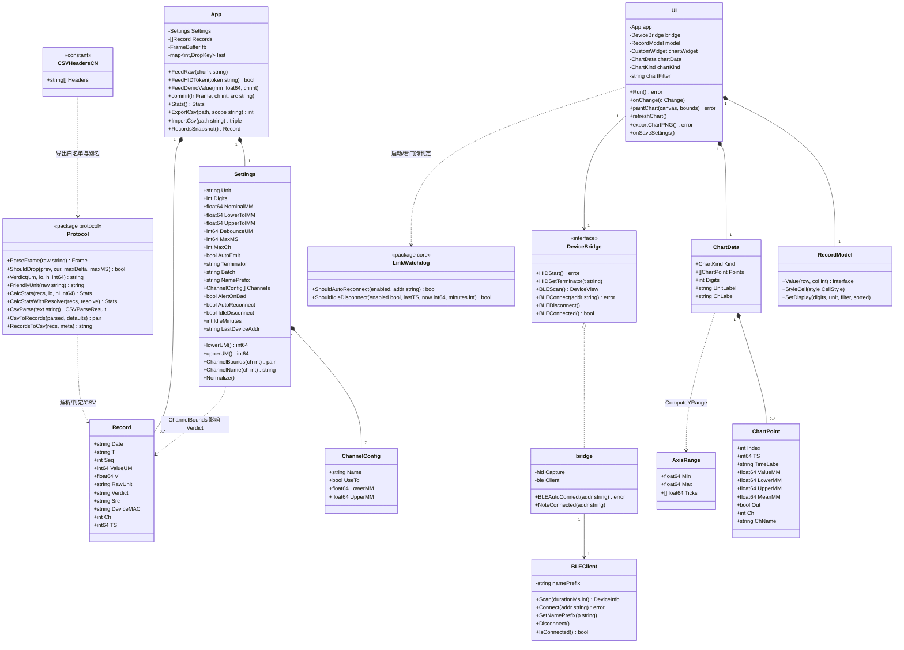
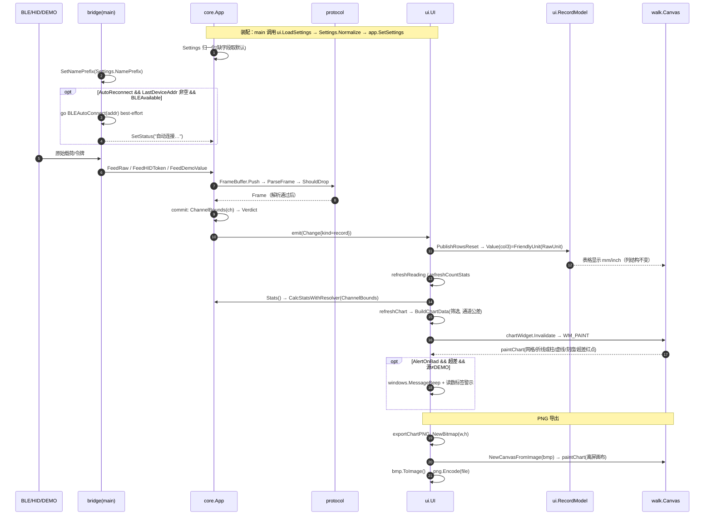
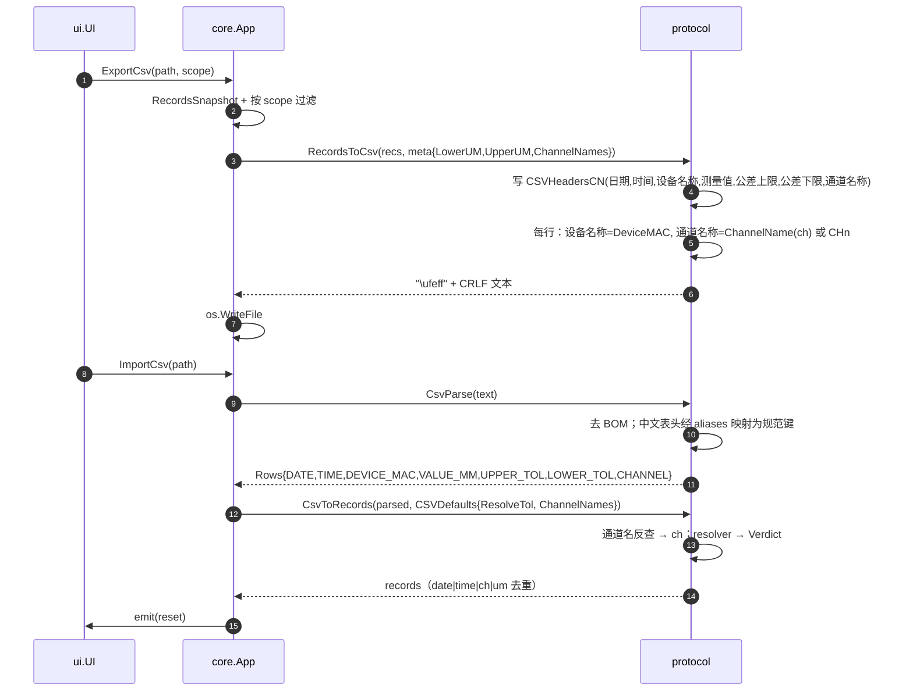
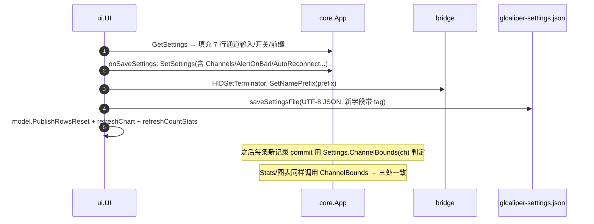
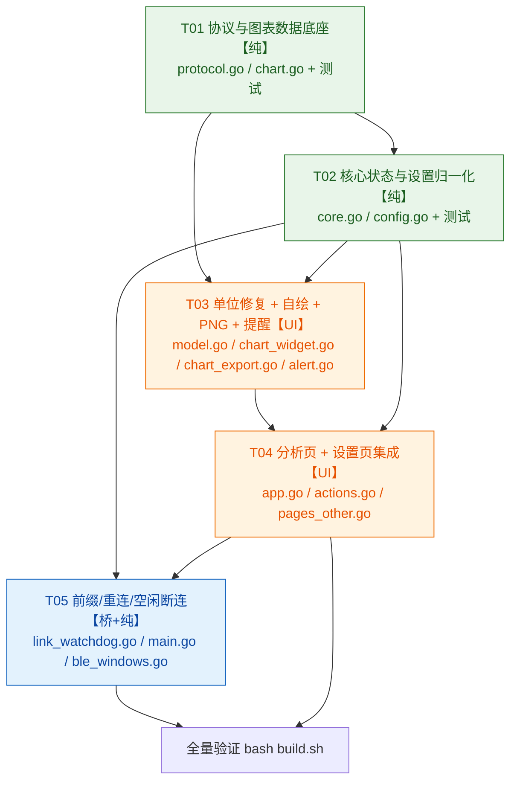

# 广陆蓝牙卡尺助手 · 原生版 增量开发系统设计与任务分解

> 架构师：高见远（Bob） · 项目：`D:/WorkBuddy工作区/app/native/` · 技术栈：Go 1.20 + `github.com/lxn/walk`（纯 Win32 原生控件，CGO_ENABLED=0，单文件 exe）
>
> 本文档**只做设计，不含实现代码**。范围严格限定为需求锁定清单：单位显示修复、CSV 中文 7 列、自绘图表、设置页 4 项扩展。

---

## 0. 范围与不变量（设计红线）

| 不变量 | 说明 |
|---|---|
| 核心数据链路不动 | `feed() → FrameBuffer.Push → ParseFrame → ShouldDrop → commit → 观察者` 的**顺序、函数签名、去抖语义**完全不改。唯一授权例外：`commit()` 内**判定时所取的公差来源**由「全局」改为「按通道」，这是需求 4 的明确要求，不改变数据流形态。 |
| 不删不加现有按钮 | 现有 5 个 Tab、所有按钮保留；新增控件只做追加（分析页加折线/柱状切换、PNG 导出、图表筛选；设置页加分组输入）。 |
| Win7 兼容 | 仅用 `walk` / `win` 已封装的 GDI 与 `golang.org/x/sys/windows` 中 Win7 存在的 API；蜂鸣用 `windows.MessageBeep`（user32，Win7 可用），不用 GDI+ 加载项、不用新内核 API、不引入 cgo。 |
| 可测性 | 所有判定、映射、缩放、配置归一化逻辑落到 `protocol` / `core` 纯函数，`bash build.sh`（`go test ./protocol/ ./core/`）必须全绿。UI 层仅做绑定与 GDI 绘制。 |
| 持久化 | 仍写 `glcaliper-settings.json`（exe 同目录），缺字段按默认值，旧文件可继续读取。 |

---

# Part A · 系统设计

## 1. 实现方案总览（每个需求的落点文件与方法）

### 1.1 核心难点分析

1. **CSV 双格式兼容**：导出改为中文 7 列，但 `CsvParse` 同时承担「解析旧 16 列英文 CSV」与「解析新 7 列中文 CSV」两个职责。不能简单替换 `CSVHeaders`（它是解析白名单），否则旧文件与现有单测 `TestCsvRoundTrip` 会失效。方案：**保留 `CSVHeaders`（16 列）作为解析白名单，新增 `CSVHeadersCN`（7 列）仅用于导出**，并补齐 4 个中文别名。
2. **通道名回导入**：新 7 列的「通道名称」若写自定义名（如"外径"），现有 `CsvToRecords` 只认 `CHn` 数字后缀，会解析失败并回退到默认通道 → 破坏 roundtrip。方案：给 `CSVDefaults` 增加**通道名→通道号反查表**纯逻辑回调。
3. **每通道公差与全局统计的语义统一**：`commit()` 落库判定、`App.Stats()` 的合格率、图表参考线三处必须取**同一套**公差，否则界面会出现"表格判合格、图表判超差"的自相矛盾。方案：在 `core.Settings` 上定义唯一真源 `ChannelBounds(ch)`，三处统一调用。
4. **walk Canvas 离屏 PNG 导出**：已核实工具链内 walk 版本提供 `NewBitmap(size)` → `NewCanvasFromImage(bitmap)` → `bitmap.ToImage() (*image.RGBA)`，配合标准库 `image/png.Encode` 即可导出 PNG，**无需 GDI+、无需新依赖、Win7 可用、无 cgo**。这是本次设计采用的主方案（详见 §5.1）。
5. **设置项的向后兼容**：`encoding/json` 反序列化缺字段得零值，直接用零值会导致 `IdleMinutes=0`（被当成关闭）、通道公差全 0（全超差）等问题。方案：在 `core` 层提供 `Settings.Normalize()` 纯函数，`ui.LoadSettings` 在读文件后统一调用。

### 1.2 需求 → 落点矩阵

| # | 需求 | 纯逻辑落点（可单测） | UI 绑定落点 | 关键方法 |
|---|---|---|---|---|
| 1 | 单位显示 `m→mm` / `i→inch` | `protocol.FriendlyUnit(raw string) string` | `ui/model.go` `Value()` case 3 | 表格仍 6 列，只改第 3 列（索引 3）返回值 |
| 2 | CSV 中文 7 列 + 可回导入 | `protocol.CSVHeadersCN`、`aliases` 补 4 项、`RecordsToCsv` 改 7 列、`CSVDefaults.ChannelNames` 反查 | `ui/pages_other.go` 导出页说明文案（`core.ExportCsv` 自动生效） | 保持 `CSVHeaders`（16）作解析白名单；BOM 保留 |
| 3a | 折线/柱状自绘图表 | `core/chart.go`：`ChartPoint/ChartData/AxisRange/ComputeYRange/FitY/BuildChartData` | `ui/chart_widget.go`：`paintChart`（Canvas GDI）；`ui/pages_other.go` 分析页加 `CustomWidget` + 切换按钮 + 筛选 | 公差/均值虚线 `walk.PenDash`；超差点红色 |
| 3b | PNG 导出 | —（复用同一 `paintChart`） | `ui/chart_export.go`：`exportChartPNG` | `NewBitmap` → `NewCanvasFromImage` → `ToImage` → `png.Encode` |
| 4a | 通道名 + 独立公差 | `core.Settings.Channels`、`ChannelBounds(ch)`、`ChannelName(ch)`、`protocol.CalcStatsWithResolver`；`commit()` 与 `Stats()` 改取通道公差 | `ui/pages_other.go` 设置页 Grid（7 行）；`ui/actions.go` 保存/恢复 | 空/未启用通道回退全局公差 |
| 4b | 超差提醒 | — | `ui/alert.go`：`windows.MessageBeep` + 读数标签闪红 | 仅在"record"变更且超差且非 DEMO 时触发 |
| 4c | 自动重连/空闲断连 | `core/link_watchdog.go`：`ShouldAutoReconnect` / `ShouldIdleDisconnect` 纯判定 | `main.go` 启动 best-effort 重连 + 独立看门狗 ticker；`ble.SetNamePrefix` | HID/DEMO 下无连接概念 → 明确 no-op |
| 4d | 广播名前缀 + HID 终止符 | `Settings.NamePrefix`、`Settings.Terminator`（后者已存在） | `ble.Client.SetNamePrefix`；设置页"设备登记"分组 | 前缀用于 `Scan()` 过滤；终止符已有链路不改 |

### 1.3 架构模式

沿用现有分层，不需要新框架、不改 `go.mod`：

```
main.go（装配 + 硬件桥 + 启动/看门狗）
  └─ ui/      declarative 布局 + walk 控件 + Canvas 自绘   ← 仅显示与绑定
       └─ core/     App 状态 + 统一数据链路 + Settings/公差/图表数据  ← 纯逻辑，可测
            └─ protocol/  帧解析/去抖/CSV/统计/单位映射                ← 纯逻辑，可测
```

---

## 2. 数据结构设计

### 2.1 `core.Settings` 扩展字段（含 JSON 兼容策略）

在 `core/core.go` 的 `Settings` 结构体**末尾追加**字段（不改已有字段、不给已有字段加 tag，避免破坏现有 JSON key）：

```go
// —— 新增：设备登记（4d）——
Terminator  string  // 已存在：HID 终止符 "ENTER"|"TAB"
NamePrefix  string  `json:"namePrefix"`  // 新增：广播名前缀，默认 "GL-BLE#"

// —— 新增：每通道名称 + 独立公差（4a）——
Channels    [7]ChannelConfig `json:"channels"`  // CH1..CH7，定长数组

// —— 新增：超差提醒（4b）——
AlertOnBad  bool `json:"alertOnBad"`

// —— 新增：自动重连 / 空闲断连（4c）——
AutoReconnect bool `json:"autoReconnect"`
IdleDisconnect bool `json:"idleDisconnect"`
IdleMinutes   int  `json:"idleMinutes"`   // 默认 5
LastDeviceAddr string `json:"lastDeviceAddr"` // 记忆上次成功连接的地址
```

每通道配置：

```go
type ChannelConfig struct {
    Name    string  `json:"name"`    // 自定义名；空串表示显示 "CHn"
    UseTol  bool    `json:"useTol"`  // true=使用该通道独立上下限；false=回退全局
    LowerMM float64 `json:"lowerMM"` // 绝对下限（mm）
    UpperMM float64 `json:"upperMM"` // 绝对上限（mm）
}
```

**默认值与回退规则**（`core.DefaultSettings()` 扩展 + `Settings.Normalize()` 纯函数）：

| 字段 | 默认 | 缺字段/非法值处理 |
|---|---|---|
| `NamePrefix` | `protocol.NamePrefix`（`GL-BLE#`） | 空串 → 默认 |
| `Channels[i].Name` | `""`（显示回退 `CHn`） | 空串合法 |
| `Channels[i].UseTol` | `false` | 缺字段即 false → **回退全局公差** |
| `Channels[i].LowerMM/UpperMM` | `0` | 未启用时忽略 |
| `AlertOnBad` | `false` | 缺字段即 false（不改变旧行为） |
| `AutoReconnect` / `IdleDisconnect` | `false` | 缺字段即 false |
| `IdleMinutes` | `5` | `<=0` → 5 |
| `LastDeviceAddr` | `""` | 空串合法 |

`Settings.Normalize()` 收拢现有 `ui/config.go` 中的 `Digits/MaxCh/DebounceUM/MaxMS/Terminator/Unit/Batch` 校验 + 上述新字段校验，`ui.LoadSettings()` 在读文件后仅调用 `saved.Normalize()`；`onResetSettings()` 用 `DefaultSettings()`（已含默认新字段）→ **旧配置文件无需迁移，缺字段自动取默认**。

> 决策：`LowerMM/UpperMM` 定义为**绝对上下限（mm）**而非相对公称的偏差，因为不同通道可能测不同尺寸，且图表参考线需要绝对坐标。全局公差换算仍为 `[NominalMM+LowerTolMM, NominalMM+UpperTolMM]`（与现状一致）。`UseTol=true` 但 `UpperMM <= LowerMM`（用户只勾了开关没填数）时**同样回退全局**，避免全超差误判。

### 2.2 每通道公差的存储与判定改写方案

**唯一真源** —— 在 `core.Settings` 上新增两个纯方法：

```
ChannelBounds(ch int) (lowerUM, upperUM int64)
  └─ ch∉[1,7] 或 !UseTol 或 UpperMM<=LowerMM → 回退 s.lowerUM()/s.upperUM()
     否则 → int64(LowerMM*1000), int64(UpperMM*1000)

ChannelName(ch int) string
  └─ ch∈[1,7] 且 Channels[ch-1].Name 非空 → 该名字；否则 "CHn"
```

三处统一改造（保证一致性）：

| 调用点 | 现状 | 改为 |
|---|---|---|
| `core.App.commit()` | `protocol.Verdict(fr.ValueUM, s.lowerUM(), s.upperUM())` | `lo, hi := s.ChannelBounds(ch)` → `protocol.Verdict(fr.ValueUM, lo, hi)` |
| `core.App.Stats()` | `CalcStats(recs, lo, hi)`（全局） | `CalcStatsWithResolver(recs, s.ChannelBounds)` |
| 图表参考线/超差点 | 无 | `BuildChartData` 内对每条记录调用 `s.ChannelBounds(r.Ch)` |

`protocol.CalcStatsWithResolver(recs []Record, resolve func(ch int)(int64,int64)) Stats` 为新增纯函数；保留原 `CalcStats(recs, lowerUM, upperUM)` 作为「常量 resolver」包装，向后兼容现有调用与单测。`Stats` 结构体字段不变（**7 项统计数值保持原样**）。

`ImportCsv` 的 `CSVDefaults` 追加可选 `ResolveTol func(ch int)(int64,int64)`，让导入记录的判定也走通道公差（为空则维持当前全局行为）。

### 2.3 图表数据模型（`core/chart.go`，纯逻辑）

```go
type ChartKind string
const (
    ChartLine ChartKind = "line"
    ChartBar  ChartKind = "bar"
)

type ChartPoint struct {
    Index     int
    TS        int64
    TimeLabel string  // "HH:MM:SS"，由 Record.T 得到
    ValueMM   float64
    LowerMM   float64 // 该点所属通道公差下限
    UpperMM   float64 // 该点所属通道公差上限
    MeanMM    float64 // 当前筛选集合的均值
    Out       bool    // 超差点 → 醒目红
    Ch        int
    ChName    string
}

type ChartData struct {
    Kind      ChartKind
    Points    []ChartPoint
    Digits    int
    UnitLabel string       // "mm" | "in"
    ChLabel   string       // "全部通道" | "CHn 名称"
}

type AxisRange struct {
    Min, Max float64
    Ticks    []float64     // 右侧 Y 轴 mm 刻度值
}

// 纯函数
BuildChartData(recs []Record, s Settings, filter string) ChartData
ComputeYRange(pts []ChartPoint) AxisRange   // 纳入 max(upper)/min(lower) + 10% padding，生成 5 个刻度
FitY(v float64, r AxisRange, topPx, bottomPx int) int
FitX(i, n, leftPx, rightPx int) int
```

`BuildChartData` 负责：按 `filter`（`""` 或 `"CHn"`）筛记录 → 逐点取通道公差 → 计算均值 → 判定 `Out`。`DrawChart` 只读该结构，不做业务判断，方便单测覆盖数据与缩放。

### 2.4 类图（Mermaid classDiagram）



> 完整源码见 `docs/class-diagram.mermaid`。

---

## 3. 文件清单（相对 `native/`，改 = 修改，新 = 新建）

| 文件 | 类型 | 改动要点 |
|---|---|---|
| `src/protocol/protocol.go` | 改 | 新增 `FriendlyUnit`；新增 `CSVHeadersCN`（中文 7 列）；`aliases` 补 `设备名称/公差上限/公差下限/通道名称`；`CSVDefaults` 加 `ChannelNames []string` 与 `ResolveTol` 回调；`CsvToRecords` 支持中文通道名反查 + resolver 判定；`RecordsToCsv` 改为导出 7 列（仍带 BOM）；新增 `CalcStatsWithResolver`（`CalcStats` 变包装） |
| `src/protocol/protocol_test.go` | 改 | 新增：单位映射、中文 7 列 roundtrip、4 别名解析、自定义通道名反查、resolver 统计、BOM/7 列表头断言 |
| `src/core/chart.go` | 新 | `ChartKind/ChartPoint/ChartData/AxisRange`；`BuildChartData/ComputeYRange/FitY/FitX` 纯函数 |
| `src/core/chart_test.go` | 新 | 筛选、均值、超差标记、Y 轴范围与刻度、像素映射测试 |
| `src/core/core.go` | 改 | `Settings` 追加新字段；`ChannelConfig`；`DefaultSettings` 扩展；`Normalize`；`ChannelBounds/ChannelName`；`commit` 判定改通道公差；`Stats` 改 resolver；`ImportCsv` 传 resolver + `ChannelNames`；`ExportCsv` 传通道名给 meta |
| `src/core/core_test.go` | 改 | 通道公差判定/回退、逐通道合格率统计、7 列 CSV 回导入、配置缺省兼容、导入通道名反查 |
| `src/ui/config.go` | 改 | `LoadSettings` 改为调用 `saved.Normalize()`；`saveSettingsFile` 不变（新字段随 JSON 自动持久化） |
| `src/ui/model.go` | 改 | `Value()` case 3：`r.RawUnit` → `protocol.FriendlyUnit(r.RawUnit)`；其余列不动 |
| `src/ui/chart_widget.go` | 新 | `UI.paintChart`（Canvas GDI：网格/折线/柱/虚线参考线/刻度/超差点/图例）；`UI.refreshChart` 重建数据并 `Invalidate` |
| `src/ui/chart_export.go` | 新 | `UI.exportChartPNG`：`NewBitmap` → `NewCanvasFromImage` → 复用 `paintChart` → `ToImage` → `png.Encode`；复用 FileDialog |
| `src/ui/alert.go` | 新 | `UI.maybeAlertOnBad(rec)`：`windows.MessageBeep` + 读数标签警示色（非 DEMO 源才蜂鸣） |
| `src/ui/app.go` | 改 | `UI` 新增字段：`chartWidget *walk.CustomWidget`、`chartData core.ChartData`、`chartKind core.ChartKind`、`chartFilter string`、切换按钮/PNG 按钮/分析页筛选/设置页新输入控件；`onChange` 增图表刷新与超差提醒；`Run()` 初始化图表 |
| `src/ui/actions.go` | 改 | `refreshSettingsInputs` / `onSaveSettings` / `onResetSettings` 读写全部新设置；前缀变化同步 `bridge`；`refreshAnalysis` 调 `u.refreshChart()` |
| `src/ui/pages_other.go` | 改 | `pageAnalysis` 加图表 `CustomWidget` + 折线/柱状切换 + PNG 导出 + 通道筛选（7 项统计保留在原位）；`pageSettings` 加「通道名与公差」7 行 Grid、「提醒与链路」开关、「设备登记」前缀/终止符；`pageExport` 文案改中文 7 列说明（按钮不变） |
| `src/core/link_watchdog.go` | 新 | `ShouldAutoReconnect` / `ShouldIdleDisconnect` 纯判定函数（时间比较与开关判断，无 Win32 依赖） |
| `src/core/link_watchdog_test.go` | 新 | 自动重连开关/空地址、空闲断连边界（0/负数/刚好等于阈值）测试 |
| `src/main.go` | 改 | `bridge` 实现 `BLEAutoConnect/NoteConnected`；启动时 best-effort 自动重连；成功连接记录 `LastDeviceAddr`；独立 1s 看门狗 ticker 调 `ShouldIdleDisconnect`；前缀/终止符注入 |
| `src/ble/ble_windows.go` | 改 | `Client` 增 `namePrefix` 字段与 `SetNamePrefix(p)`；`Scan()` 由硬编码 `GL-BLE#` 改为 `c.namePrefix` |
| `build.sh` | 不改 | 仍 `go test ./protocol/ ./core/`；新测试文件自动纳入 |
| `go.mod` | 不改 | `image/png` 为标准库；无新增第三方依赖 |

---

## 4. 程序调用流程（Mermaid sequenceDiagram）

### 4.1 关键操作总流程（落库 → 显示 → 提醒 → 图表 → 导出）



### 4.2 CSV 导出 → 重新导入（中文 7 列闭环）



### 4.3 设置保存 → 判定链路生效



> 完整时序图见 `docs/sequence-diagram.mermaid`（含空闲断连看门狗分支）。

---

## 5. 依赖与风险

### 5.1 walk Canvas 离屏 PNG 导出的可行性（已核实工具链源码）

已在本项目工具链 `walk@v0.0.0-20210112085537-c389da54e794` 中确认以下 API 存在：

- `walk.NewBitmap(size Size) (*Bitmap, error)` —— 创建 DIB 位图（无窗口依赖）。
- `walk.NewCanvasFromImage(image Image) (*Canvas, error)` —— `case *Bitmap` 分支用 `CreateCompatibleDC` + `SelectObject` 构造离屏 HDC。
- `Canvas` 提供 `DrawLine/DrawPolyline/DrawRectangle/FillRectangle/DrawText/DrawEllipse/DrawImage`，`NewCosmeticPen(PenDash, color)` 提供**虚线画笔** —— 满足公差/均值虚线需求。
- `(*Bitmap).ToImage() (*image.RGBA, error)` —— 用 `GetDIBits(BI_RGB)` 导出像素。
- 标准库 `image/png.Encode(io.Writer, image.Image)` —— 纯 Go，**无需 GDI+、无需新依赖、无 cgo、Win7 可用**。

**主方案**：把屏幕绘制函数写成 `func (u *UI) paintChart(canvas *walk.Canvas, bounds walk.Rectangle) error`，屏幕 `CustomWidget.Paint` 与离屏导出**复用同一个函数**，保证"所见即所得"；导出时用固定逻辑尺寸（建议 `1200×700 @96dpi`），先 `FillRectangle` 白底再绘制，最后 `png.Encode`。

**降级方案 A**（若 `ToImage` 在某些 DPI/色深下异常）：用 `walk.NewBitmapWithTransparentPixels` 或显式 24bpp 尺寸重建位图；仍走同一 Canvas。
**降级方案 B**（极端情况下无法离屏 Canvas）：用 `os/exec` 调用系统自带 "画图" 不可行（非用户无感）→ **不采用**；真失败时至少导出 CSV（已有能力）并在状态栏明确提示，绝不让程序崩溃。
**风险点**：`ToImage` 对 32bpp 位图的 alpha 通道处理 —— 导出前用不透明白底填充可规避。

### 5.2 每通道公差对 `Verdict` / `Stats` 的影响

| 受影响处 | 影响 | 控制措施 |
|---|---|---|
| `commit()` 落库判定 | 新记录按通道公差判合格/超差 | 唯一真源 `ChannelBounds`；`UseTol=false` 时与旧行为**完全一致** |
| `App.Stats()` 7 项 | `OK/OKRate` 改为逐点按所属通道判定；`N/Mean/Max/Min/SD` 不变 | 新增 `CalcStatsWithResolver`，旧 `CalcStats` 保留；旧单测继续通过 |
| 表格"判定"列 | 显示 `r.Verdict`，随新记录改变 | 不回溯重算历史记录（历史判定是当时快照，符合"每次测量留痕"语义） |
| 图表参考线/超差点 | 每点用所属通道上下限 | `BuildChartData` 统一取 `ChannelBounds` |
| 导出 CSV 的公差列 | 写该记录通道的上下限（绝对 mm） | `ExportCsv` 从 `ChannelBounds` 生成，不写死全局 |
| 空通道公差回退 | 未启用/非法配置 → 全局 `[Nominal±Tol]` | `ChannelBounds` 单一判断点，单测覆盖 3 种回退场景 |

**一致性断言**：`commit` 判定、`Stats` 判定、图表超差标记三者对同一条记录必须同结论 —— 加入 `core_test` 交叉断言。

### 5.3 其他风险与对策

| 风险 | 对策 |
|---|---|
| `设备名称`列对实时 BLE 记录为空（`Record.DeviceMAC` 现仅在导入时填充，`commit` 未写） | **待明确**（§6-1）；设计上导出取 `r.DeviceMAC`，空则留空；可选在 `commit` 时写入当前连接地址（需 bridge 回调，属低风险增量） |
| 自定义通道名如"外径"无法被旧 `CsvToRecords` 解析 | `CSVDefaults.ChannelNames` 反查表已覆盖；若名重复取首个匹配，其余回退默认通道 |
| 自动重连在 Win7 / HID / DEMO 下无意义 | 明确边界：`!BLEAvailable()` 或模式非 BLE → 直接 no-op，状态栏提示，不报错 |
| 空闲断连误伤 | 仅 `BLEConnected()==true` 时生效；HID 无"连接"状态、DEMO 由用户显式启停 → 均 no-op；阈值 `IdleMinutes<=0` 视为关闭 |
| 蜂鸣在无声卡机器无效果 | `MessageBeep` 失败静默；同时强制界面警示色（"至少界面警示"兜底） |
| 分析页新增控件挤压现有 7 项统计 | 图表放统计区**下方**，`MinSize` + `StretchFactor` 布局；按钮行独立 HBox，不删原统计 Label |
| 高频绘制性能（演示模式 600ms/条） | `paintChart` 只做 O(n) 绘制；`refreshChart` 在 `Synchronize` 内合并；建议 `PaintMode: PaintBuffered` 双缓冲避免闪烁 |

---

## 6. 待明确事项（含设计采用的默认口径）

1. **「设备名称」列取值**：当前实时记录未保存设备名（`Record.DeviceMAC` 仅导入填充）。设计默认导出 `r.DeviceMAC`（实时记录为空则留空）。若需实时填上，需在 `commit` 前把当前连接设备名/地址注入 `Record`——请确认是否纳入本次范围（建议：纳入，改动很小）。
2. **「公差上限/下限」语义**：设计采用**绝对上下限（mm）**。若安卓 APP 实际写的是相对偏差（如 ±0.05），请确认，导出取值处一行可切。
3. **「通道名称」导出值**：设计写自定义名（未设置写 `CHn`），并配套反查保证回导入。若安卓 APP 期望固定 `CHn` 字面值，可改为固定输出（反查逻辑保留兼容）。
4. **超差提醒是否覆盖演示模式**：设计默认**跳过 DEMO**（否则 600ms 一条会持续蜂鸣）。如需全量提醒，去掉源判断即可。
5. **自动重连策略**：设计采用「启动时一次性 best-effort，沿用 `ble.Connect` 8s 超时，失败仅提示不重试」。如需断线后周期重连，需扩展看门狗状态机。
6. **PNG 尺寸/DPI**：设计默认固定 `1200×700 @96dpi`。如需跟随控件实际尺寸，导出前读 `chartWidget.Bounds()` 即可。
7. **历史记录判定是否随新公差重算**：设计默认**不回溯**（保留测量当时快照）。如需重算，需在 `Stats`/表格/图表统一改为动态判定。

> 以上 7 项均有可落地默认口径，**不阻塞开工**；已按默认口径写入任务分解。

---

# Part B · 任务分解

## 7. Required Packages（依赖清单）

无新增第三方依赖。`go.mod` 保持不变。设计使用到的现有/标准库：

```
- github.com/lxn/walk v0.0.0-20210112085537-c389da54e794 : 原生控件 + Canvas GDI + CustomWidget + Bitmap 离屏画布（已在 go.mod）
- github.com/lxn/win   v0.0.0-20210218163916-a377121e959e : PS_DASH 等 GDI 常量（walk 传递依赖）
- golang.org/x/sys     v0.15.0                            : windows.MessageBeep / GetVersion（已在 go.mod）
- tinygo.org/x/bluetooth v0.10.0                          : BLE 扫描/连接（已在 go.mod）
- image/png, image, os, encoding/json, fmt, strconv       : Go 1.20 标准库，PNG 编码/JSON 持久化
```

## 8. 任务列表（按依赖顺序，共 5 个）

> 标注：**【纯】**=纯逻辑可单测、可并行；**【UI】**=walk 控件绑定/绘制；**【桥】**=硬件联动。

### T01 — 协议与图表数据底座 【纯】

- **Source Files**：`src/protocol/protocol.go`（改）、`src/protocol/protocol_test.go`（改）、`src/core/chart.go`（新）、`src/core/chart_test.go`（新）
- **Dependencies**：无（起点，可与其它任务的前置准备并行）
- **Priority**：P0
- **交付**：`FriendlyUnit`；`CSVHeadersCN` + 4 别名补齐 + `RecordsToCsv` 7 列（BOM）；`CSVDefaults.ChannelNames/ResolveTol` 与 `CsvToRecords` 反查；`CalcStatsWithResolver`；`core.ChartData/ChartPoint/AxisRange` 与 4 个纯函数；全部单测通过。
- **验收**：`go test ./protocol/ ./core/` 通过；中文 7 列导出→解析→回导入零丢失、零 skipped 列；旧 16 列 CSV 仍可导入。

### T02 — 核心状态、每通道公差与设置归一化 【纯】

- **Source Files**：`src/core/core.go`（改）、`src/core/core_test.go`（改）、`src/ui/config.go`（改）
- **Dependencies**：T01（复用 `CalcStatsWithResolver`、`BuildChartData` 所需类型）
- **Priority**：P0
- **交付**：`Settings` 新字段/`ChannelConfig`/`DefaultSettings`/`Normalize`/`ChannelBounds`/`ChannelName`；`commit` 与 `Stats` 改走通道公差；`ImportCsv`/`ExportCsv` 传 resolver 与通道名；`LoadSettings` 调 `Normalize`。
- **验收**：空/未启用/非法公差回退全局；三处判定交叉一致；旧 JSON（缺新字段）加载后行为与旧版一致；7 项统计数值保持。

### T03 — 显示层：单位修复 + 图表自绘 + PNG + 超差提醒 【UI】

- **Source Files**：`src/ui/model.go`（改）、`src/ui/chart_widget.go`（新）、`src/ui/chart_export.go`（新）、`src/ui/alert.go`（新）
- **Dependencies**：T01（图表数据模型）、T02（`Settings` 通道名/公差）
- **Priority**：P0
- **交付**：表格单位列显示 `mm/inch`（6 列不变）；`paintChart` 折线/柱状 + 琥珀公差虚线 + 均值虚线 + 右侧 mm 刻度 + 底部时间刻度 + 超差点红色 + 图例；`exportChartPNG` 离屏导出；`maybeAlertOnBad`（MessageBeep + 界面警示）。
- **验收**：`bash build.sh` 编译通过；PNG 能用看图工具打开且内容与屏幕一致；Win7 上不调用新 API。

### T04 — 页面集成：分析页图表 + 设置页 4 项扩展 + 动作绑定 【UI】

- **Source Files**：`src/ui/app.go`（改）、`src/ui/actions.go`（改）、`src/ui/pages_other.go`（改）
- **Dependencies**：T02、T03
- **Priority**：P0
- **交付**：分析页加 `CustomWidget` + 折线/柱状切换 + PNG 按钮 + 通道筛选（7 项统计原位保留）；设置页加 7 行通道名/公差 Grid、提醒/自动重连/空闲断连开关与分钟数、前缀登记（终止符沿用）；`onChange` 增图表刷新与提醒；`onSaveSettings/onResetSettings/refreshSettingsInputs` 覆盖新字段；`pageExport` 文案改中文 7 列。
- **验收**：不删除任何现有按钮/页；保存后重启配置保留；切换通道公差后新记录判定与图表同步变化。

### T05 — 硬件联动：前缀注入 + 自动重连 + 空闲断连 【桥 + 纯】

- **Source Files**：`src/core/link_watchdog.go`（新）、`src/core/link_watchdog_test.go`（新）、`src/main.go`（改）、`src/ble/ble_windows.go`（改）
- **Dependencies**：T02（Settings 新字段）、T04（bridge 需与 UI 注入点对齐）
- **Priority**：P1
- **交付**：`ShouldAutoReconnect/ShouldIdleDisconnect` 纯判定 + 单测；`ble.SetNamePrefix` 并用于 `Scan` 过滤；启动 best-effort 自动重连；成功连接记忆 `LastDeviceAddr`；独立 1s 看门狗空闲断连；HID/DEMO/Win7 边界 no-op 与状态提示。
- **验收**：`go test ./core/` 通过；关闭开关时行为与旧版一致；Win7 无 BLE 时启动不报错。

### 并行性说明

```
T01（纯，起点）
 ├─ T02（纯）────┬─ T03（UI）──┐
 │               │             ├─ T04（UI 集成）
 └───────────────┴─ T05（桥）─┘
```
- **可并行**：T02 与 T01 的图表类型准备无冲突；T03、T05 在 T02 完成后可**并行开发**（分属不同文件）；T04 为最终集成点。
- 实际落地建议顺序：T01 → T02 → (T03 ∥ T05) → T04 → 全量 `bash build.sh`。

## 9. Shared Knowledge（跨任务约定，工程师必读）

- **唯一真源**：任何"公差"取值一律走 `core.Settings.ChannelBounds(ch)`；不得在 UI 里再写一份 `(Nominal+Tol)*1000`。
- **单位口径**：内部一律存 `ValueUM`（微米整数）；显示/导出才转 mm（`protocol.ToMM`），`RawUnit` 是协议原始 `m|i`，显示必须经 `FriendlyUnit`，**绝不直接显示 `RawUnit`**。
- **CSV 双格式**：`CSVHeaders`（16 列英文）只做**解析白名单**；`CSVHeadersCN`（7 列中文）只做**导出表头**。导出必须 `"\ufeff" + CRLF` 结尾。新增中文表头必须同时补 `aliases` 才能回导入。
- **判定值域**：`Verdict` 返回 `"合格" | "超差"`（中文），`Stats.OKRate` 为四舍五入整数百分比。
- **配置兼容**：`LoadSettings` 必须先 `DefaultSettings()` 再 `Normalize()`；新字段一律带 JSON tag 且在 `DefaultSettings` 有默认值；缺字段不得导致全超差或功能误开。
- **线程/UI**：`core.App` 的所有变更经 `OnChange` 回调，UI 侧必须 `main.Synchronize(...)` 后再操作控件；图表 `Invalidate()` 也必须在 UI 线程。
- **GDI 资源**：`NewCosmeticPen/NewSolidBrush/NewFont` 等 GDI 对象用完 `Dispose()`；`paintChart` 内创建的临时对象建议 `defer`/`withPen` 释放，避免高频绘制泄漏。
- **字体**：等宽数字沿用 `fontCellBold` / `Consolas`；图表刻度文字用 `DrawText` + 96DPI 单位。
- **Win7 红线**：不用 GDI+、不用 `windows.MessageBeep` 以外的音频 API、不引入 cgo、不改 `-H=windowsgui`。
- **测试命令**：`bash build.sh`（内含 `go test ./protocol/ ./core/`），不得单独只跑编译跳过测试。

## 10. Task Dependency Graph（Mermaid）



---

## 附：交付物索引

- 本文档：`docs/system_design.md`
- 类图：`docs/class-diagram.mermaid`
- 时序图：`docs/sequence-diagram.mermaid`
